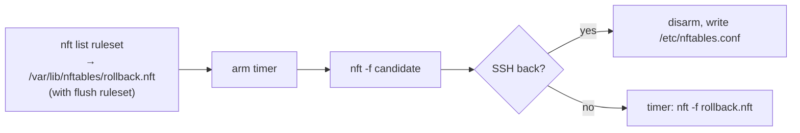

# Coexistence with other firewall writers

Findings and working decisions from 2026-10-23/24: how nftgen's output and
the ansible-firewall role behave on hosts where Docker, Kubernetes, libvirt
or fail2ban also write rules.

| Part | State |
| --- | --- |
| Rollback from the previous `/etc/nftables.conf` (fix B) | ansible-firewall 0.3.1 (#70) |
| `reset: own-tables` in nftgen | built: [DESIGN.md](../DESIGN.md) (`reset:`), [DECISIONS.md](../DECISIONS.md) §5.4, tests B29–B31 |
| Role side: `nftables_reset`, ownership check, takeover, rollback composition | built in ansible-firewall (branch `feat/own-tables`), as below |

## Decisions so far

| Topic | Decision |
| --- | --- |
| Reset modes | Two: `flush ruleset` (today) and *own tables*. The author picks the mode per host; nftgen derives the table list. Tables dropped from the YAML are removed by the role (no `retired:` key — dropped 2026-10-24). Hand-written resets are rejected: a table left out doubles its rules on every apply. |
| Own-tables reset | `destroy table X` per table — [DESIGN.md](../DESIGN.md#project-layout) `reset:`, why in [DECISIONS.md](../DECISIONS.md) §5.4. No `add`+`delete` fallback. |
| Rollback bug | Fix with **B**: roll back to the previous `/etc/nftables.conf`. **A** (live snapshot of our own tables) stays a possible later addition. |
| Distro service | Awareness only; no systemd drop-in. |
| Taken table names | Document; no reject, no warning. |
| Same-priority chains | Document. |

## Why it matters: verdicts across base chains

Every base chain on a hook is a separate checkpoint, in any table.
Inside one chain the first matching verdict ends it. Between chains:

- `accept` ends only the current base chain; the packet goes on to the next
  base chain on the hook (next higher priority) and to later hooks.
- `drop` is final at once.

So another tool's drop beats our accept, and our `policy drop` beats its
accept. Verified in a netns, nft 1.1.7: accept in table `a` at priority -10,
drop in table `b` at 0 → the ping is dropped and both counters show 1.

## The rollback bug

The role's dead-man rollback (ansible-firewall
`roles/nftables/tasks/deploy.yml`):



`nft list ruleset` prints rules written by iptables-nft (Docker, Calico,
kube-router, ufw, …) in nft syntax only where libxtables has a translation.
Where it has none, it prints a display-only placeholder:

```text
ip daddr 10.42.0.5 xt match "physdev" counter jump KUBE-POD-FW-ABC
```

`nft -f` rejects that line, and with it the whole file (one transaction):
`Error: unsupported xtables compat expression, use iptables-nft with this
ruleset`. Nothing is restored; the bad ruleset stays until a reboot (the old
`/etc/nftables.conf` is still on disk, so a reboot recovers).

Ubuntu 22.04 (nft 1.0.2) is worse: it prints the placeholder as a `#`
comment, so the restore *succeeds* with the match silently gone, e.g.
kube-router's `! match-set kube-router-local-pods` → `ip saddr
10.42.0.0/24 … reject`.

### Which tools trigger it

Each tool's default iptables rules (rebuilt from its source), our table, the
role's snapshot, a `policy drop` lockout, then the dead-man restore — in
distro containers on kernel 7.3, so only userspace varies.

| Tool (default config) | Ubu 22.04 | Ubu 24.04 | Ubu 26.04 | Breaking match |
| --- | --- | --- | --- | --- |
| Docker | ok | ok | ok | |
| Podman/netavark 1.x (2.x has no iptables) | ok | ok | ok | |
| flannel | ok | ok | ok | |
| kube-proxy, iptables mode | ok | ok | ok | |
| kube-proxy, nftables mode (+ ClientIP affinity) | not tested | not tested | ok | |
| kube-proxy, iptables mode + ClientIP affinity | wrong? | FAIL | FAIL | `recent` |
| Cilium (defaults) | ok | FAIL | ok | `socket`, `TPROXY` |
| Cilium, native routing | wrong? | FAIL | FAIL | `set` |
| Calico | FAIL | FAIL | FAIL | `set` |
| kube-router netpol | WRONG | FAIL | FAIL | `physdev`, `set` |
| libvirt, iptables backend | WRONG | FAIL | FAIL | `CHECKSUM` |

FAIL = restore rejected, lockout stays. WRONG = restore succeeds with
matches dropped (inspected). wrong? = same, inferred. Debian 12/13 and Rocky
9/10 match the Ubuntu release with the same nft generation (1.0.x: Debian 12,
Rocky 9; 1.1.x: Debian 13, Rocky 10). nft 1.1.x translates `socket` and
`TPROXY`; nothing translates `set`, `physdev`, `recent`, `CHECKSUM`.

Limits: rules are rebuilt from source, not captured from running tools; a
few mark values are placeholders. A VM with the real tool would confirm.

### The fix

| | A: live snapshot of our tables | B: previous `/etc/nftables.conf` |
| --- | --- | --- |
| Reads | the kernel (`nft list table …`) | the file on disk |
| Must pick out our tables | yes | no (only our render is in it) |
| Keeps runtime set elements and hand edits | yes, on rollback only | no |
| In own-tables mode also needs | resets for old ∪ new tables | resets for the new render's tables |

**B** first: smallest change, works with today's mode, restores what was
reviewed and confirmed reachable. A successful deploy drops runtime elements
anyway, so A's extra only shows after a failed deploy. First deploy: the old
file is the distro default, not a render (no `# generated by nftgen`
header); in own-tables mode it must not be loaded, since it starts with
`flush ruleset`.

## Own-tables mode

```nft
# generated by nftgen from gw1a — do not edit

destroy table inet filter

table inet filter { … }
```

`destroy` removes the table if it exists and does nothing otherwise (plain
`delete` fails on a missing table and aborts the file). Verified: works on an
empty ruleset, applied twice nothing doubles. Without any reset, a re-apply
appends every rule a second time.

Safeguards: no `flush ruleset` in own-tables files (a role guard, like
today's inverse check), and a test that loads other tools' tables, deploys,
forces a rollback, and asserts their tables are unchanged.

## Own-tables mode: ownership and scenarios (role side)

### Rules

- **Mode per host**, in the YAML: `reset: flush | own-tables` (role var
  `nftables_reset`, a role setting like `nftables_blame`). `flush` is the
  default and stays exactly as today; everything below applies only to the
  opt-in `own-tables`.
- **Ownership mark per table:** in an own-tables render, every table nftgen
  owns has its `destroy table X` line. No other marker.
- **Destroy lines:** all at the top, before any table body; one per
  distinct family + name, in first-seen `tables:` order. A table listed twice
  stays allowed (nft merges same-named blocks into one table).
- **On each own-tables deploy the role reads the current
  `/etc/nftables.conf`** and sorts every table it defines:

| Table in the current `/etc/nftables.conf` | Role |
| --- | --- |
| Has a `destroy` line, still rendered | Reset and rebuild |
| Has a `destroy` line, no longer rendered | Delete it (ours) |
| In a **flush-mode** nftgen render (header + `flush ruleset`) | Ours: rebuild or delete as above |
| No `destroy` line, file is not a flush-mode render (hand-written, hand-added, a top-level `include`) | **Fail** with the cause and the list; add the tables to keep to the YAML **and** re-run once with `-e nftables_takeover=true` (below) |
| Live, but in no config file (Docker, Kubernetes, fail2ban) | Never touched |

- **Takeover = one deploy with `flush ruleset`.** With
  `nftables_takeover=true` that deploy starts with `flush ruleset` (as flush
  mode); every later deploy is a clean own-tables render. It wipes foreign
  tools' tables once (Docker needs a daemon restart, kube-proxy up to 1 h),
  so do it in a maintenance window or before they're installed. No need to
  parse foreign files.
- **Takeover only acts where needed:** with `nftables_takeover` set on a
  host whose file is already nftgen's (header, and every table has a
  `destroy` line or the file is a flush-mode render), the role warns and deploys
  normally — `-e` applies to every host of the play. The file itself is the
  record; no state on the host. Left in the inventory, it warns every run.
- **Untouched package default needs no takeover:** if `/etc/nftables.conf`
  still matches dpkg's stored checksum (`dpkg-query -W -f='${Conffiles}'
  nftables`, md5), it's treated like a flush-mode render — no stop on a fresh
  host. Works on every Debian/Ubuntu release (checked 22.04, 24.04, 26.04,
  Debian 12); any edit changes the checksum and the normal stop applies.
- **Check mode** reports instead of failing ("Takeover needed: …"); before
  nftables is installed it says the real run checks after the install. The
  diff is of `/etc/nftables.conf`, which never holds the takeover's
  `flush ruleset` or the extra `destroy` lines: those go into the applied
  candidate only, in both apply paths (with and without the dead-man).
- **Finding the tables in the current file:** any spelling nft accepts
  (`table`, `add table`, `create table`, indented, family omitted = `ip`).
  nftgen has no top-level `raw:`, so a top-level `include` is never ours and
  needs a takeover; one inside a table (table `raw:`) is reset with it.
- **No configuration file:** own-tables refuses to apply (nothing to roll
  back to), like flush mode.
- **Rollback (own-tables):** `destroy` lines of the new render + the previous
  `/etc/nftables.conf` as is. If that file is our own-tables render, only our
  tables move. If it isn't (first own-tables deploy), it carries `flush
  ruleset` and a rollback wipes foreign tables — **accepted risk**.

### Scenarios

| # | Scenario | Outcome | Status |
| --- | --- | --- | --- |
| 1 | Fresh host, untouched package default config | Matches dpkg's checksum → treated as ours, no stop | agreed |
| 2 | Hand-written config (`inet filter`, `inet nat`) | Fails with both listed; takeover (one flush) or adopt | agreed |
| 3 | Hand-written config also covered another tool's table | Same as 2; the list shows it first | agreed |
| 4 | Rules change inside a table | Reset and rebuild | agreed |
| 5 | Table added | `destroy` line + body; works on first apply | agreed |
| 6 | Table removed from the YAML | Has a `destroy` line in the old file → deleted | agreed |
| 7 | Table renamed / family changed | 6 + 5 | agreed |
| 8 | Host offline during a removal, deployed later | Its old file still has the line → 6 | agreed |
| 9 | Our render edited by hand (table appended) | No `destroy` line → fails as in 2; an `include` line fails too | agreed |
| 10 | Switch flush → own-tables | Old file is a flush-mode render → all its tables ours; no takeover | agreed |
| 11 | Switch own-tables → flush | Flush wipes everything, as the mode says | agreed |
| 12 | Render fails `nft -c` | Nothing applied | as today |
| 13 | Applied, connection lost | Rollback: new tables reset, old file reloaded; foreign untouched | agreed |
| 14 | Rollback after a removal or rename | Old file brings the removed table back; new one reset away | test |
| 15 | First own-tables deploy fails (after 1, 2, 10) | Old file has `flush ruleset` → foreign tables wiped | accepted risk |
| 16 | Role rollback off (reload path) | No dead-man, as today | as today |
| 17 | Our table name equals a foreign one | We delete theirs | documented |
| 18 | Foreign tool recreates its tables mid-deploy | No effect | agreed |
| 19 | Runtime set elements in our tables | Lost on each deploy | as flush mode |
| 20 | Hand edits to our live tables | Lost on next deploy | as flush mode |
| 21 | `systemctl restart nftables` / package upgrade | Wipes everything | awareness |
| 22 | Reboot | File loads on an empty ruleset; `destroy` is a no-op | check |

### ansible-firewall plugin

`nftgen_render` gets `reset: flush | own-tables` (default `flush`) and loses
`flush:` (added in #53, unused by the role; `flush: false` rendered a file the
role refuses). A breaking change (`!`), noted in the commit; release-please
bumps 0.3.x → 0.4.0 either way. The plugin defaults `reset` to `flush` and fails
on a blank or unknown value: `render_tables(reset=None)` means "tables only",
which as a deploy file would add every rule again on each apply.

### Without the role

`nftgen build` alone renders the `destroy` lines but can't see the host. A table
dropped from the YAML stays on the host until removed once by hand
(`nft delete table inet legacy`). No `retired:` key: the role covers
removals, and nftgen comparing with its previous output would make the
output depend on more than the YAML.

## Be aware

- **Distro service (Ubuntu/Debian).** `nftables.service` runs
  `ExecStop=/usr/sbin/nft flush ruleset`, so `systemctl stop` or `restart`
  wipes every tool's tables. The package's `postinst` runs
  `deb-systemd-invoke try-restart nftables.service` on upgrade, so an
  unattended nftables update does it with nobody involved. Reload only loads
  `/etc/nftables.conf`. (RHEL's reload flushes too.) The role never stops the
  service.
- **Slow self-healing after a wipe.** kube-proxy (nftables mode) rebuilds on
  its next full sync, up to 1 h; fail2ban only on restart; Docker and libvirt
  on daemon restart. kube-proxy (iptables mode) notices via its canary chain
  and resyncs; Calico (nftables mode) refreshes every 3 min.
- **Taken table names.** Identity is family + name (`inet filter` ≠
  `ip filter`). An own-tables reset deletes a same-named table of another
  tool. nftgen's renders use `inet`, which none of these collide with; the
  trap is e.g. `table ip nat` on a router.

  | Owner | Tables |
  | --- | --- |
  | iptables-nft (Docker, Calico, kube-router, ufw, …) | `ip`/`ip6` `filter`, `nat`, `mangle`, `raw`, `security` |
  | kube-proxy, nftables mode | `ip`/`ip6` `kube-proxy` |
  | Docker, nftables backend | `ip`/`ip6` `docker-bridges` |
  | Podman/netavark | `inet netavark` |
  | libvirt, nftables backend | `ip`/`ip6` `libvirt_network` |
  | fail2ban | `inet f2b-table` |
  | firewalld | `inet firewalld` |

- **Same-priority base chains.** Order is undefined (nftables wiki); the
  kernel runs the most recently registered first, so each own-tables deploy
  moves our chains ahead of same-priority peers. Plain accept/drop results
  don't depend on it; marks, counters/logs, NAT and `notrack` do. Give such
  chains their own priority (e.g. `filter - 5`).
- **kube-proxy nftables mode** (`mode: nftables`, GA in Kubernetes 1.33,
  kernel ≥ 5.13; default is still `iptables`) does not open NodePorts in
  other firewalls: the host policy must allow the NodePort range itself.

## Sources

- nftables wiki: [Configuring chains](https://wiki.nftables.org/wiki-nftables/index.php/Configuring_chains)
  (same-priority order; accept not final),
  [Atomic rule replacement](https://wiki.nftables.org/wiki-nftables/index.php/Atomic_rule_replacement).
- Ubuntu `nftables` package: `nftables.service`, `postinst` (checked in an
  `ubuntu:26.04` container).
- Kubernetes: [Virtual IPs and Service Proxies](https://kubernetes.io/docs/reference/networking/virtual-ips/),
  feature gate `NFTablesProxyMode`; `pkg/proxy/nftables/proxier.go`.
- Cilium: [Routing](https://docs.cilium.io/en/stable/network/concepts/routing/);
  `pkg/datapath/iptables/iptables.go`.
- Tool tables: kube-proxy `proxier.go`, netavark `src/firewall/nft.rs`,
  fail2ban `config/action.d/nftables.conf`, firewalld `nftables.py`, Docker
  [nftables docs](https://docs.docker.com/engine/network/firewall-nftables/).
- Translation: iptables `iptables/nft.c` (`add_match`), nftables
  `src/xt.c` (`xt_stmt_xlate`).
