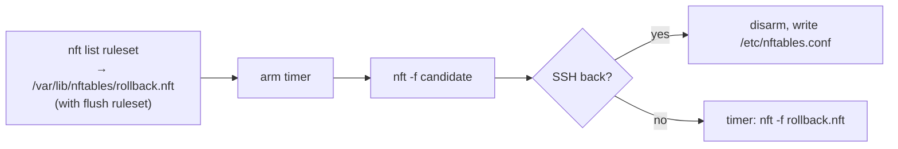

# Coexistence with other firewall writers

Findings and working decisions from 2026-10-23/24: how nftgen's output and
the ansible-firewall role behave on hosts where Docker, Kubernetes, libvirt
or fail2ban also write rules. **Nothing here is built yet**; the agreed parts
move to [DECISIONS.md](../DECISIONS.md) and [DESIGN.md](../DESIGN.md) when
they land. Open work is in [TODO.md](../TODO.md) (Deployment).

## Decisions so far

| Topic | Decision |
| --- | --- |
| Reset modes | Two: `flush ruleset` (today) and *own tables*. The author picks the mode; nftgen derives the table list; retired tables are listed by the author. Hand-written resets are rejected: a table left out doubles its rules on every apply. |
| Own-tables reset | `add table X` + `delete table X` per table. Switch to `destroy table X` once Ubuntu 22.04 is dropped (needs nft ≥ 1.0.7, kernel ≥ 6.3). |
| Rollback bug | Fix with **B**: roll back to the previous `/etc/nftables.conf`. **A** (live snapshot of our own tables) stays a possible later addition. |
| Distro service | Awareness only; no systemd drop-in. |
| Taken table names | Document; no reject, no warning. |
| Same-priority chains | Document. |

## Why it matters: verdicts across base chains

Every base chain on a hook is a separate checkpoint, in any table.
Inside one chain the first matching verdict ends it. Between chains:

- `accept` ends only the current base chain; the packet goes on to the next
  base chain on the hook (next higher priority) and to later hooks.
- `drop` is final at once.

So another tool's drop beats our accept, and our `policy drop` beats its
accept. Verified in a netns, nft 1.1.7: accept in table `a` at priority -10,
drop in table `b` at 0 → the ping is dropped and both counters show 1.

## The rollback bug

The role's dead-man rollback (ansible-firewall
`roles/nftables/tasks/deploy.yml`):



`nft list ruleset` prints rules written by iptables-nft (Docker, Calico,
kube-router, ufw, …) in nft syntax only where libxtables has a translation.
Where it has none, it prints a display-only placeholder:

```text
ip daddr 10.42.0.5 xt match "physdev" counter jump KUBE-POD-FW-ABC
```

`nft -f` rejects that line, and with it the whole file (one transaction):
`Error: unsupported xtables compat expression, use iptables-nft with this
ruleset`. Nothing is restored; the bad ruleset stays until a reboot (the old
`/etc/nftables.conf` is still on disk, so a reboot recovers).

Ubuntu 22.04 (nft 1.0.2) is worse: it prints the placeholder as a `#`
comment, so the restore *succeeds* with the match silently gone, e.g.
kube-router's `! match-set kube-router-local-pods` → `ip saddr
10.42.0.0/24 … reject`.

### Which tools trigger it

Each tool's default iptables rules (rebuilt from its source), our table, the
role's snapshot, a `policy drop` lockout, then the dead-man restore — in
distro containers on kernel 7.3, so only userspace varies.

| Tool (default config) | Ubu 22.04 | Ubu 24.04 | Ubu 26.04 | Breaking match |
| --- | --- | --- | --- | --- |
| Docker | ok | ok | ok | |
| Podman/netavark 1.x (2.x has no iptables) | ok | ok | ok | |
| flannel | ok | ok | ok | |
| kube-proxy, iptables mode | ok | ok | ok | |
| kube-proxy, nftables mode (+ ClientIP affinity) | not tested | not tested | ok | |
| kube-proxy, iptables mode + ClientIP affinity | wrong? | FAIL | FAIL | `recent` |
| Cilium (defaults) | ok | FAIL | ok | `socket`, `TPROXY` |
| Cilium, native routing | wrong? | FAIL | FAIL | `set` |
| Calico | FAIL | FAIL | FAIL | `set` |
| kube-router netpol | WRONG | FAIL | FAIL | `physdev`, `set` |
| libvirt, iptables backend | WRONG | FAIL | FAIL | `CHECKSUM` |

FAIL = restore rejected, lockout stays. WRONG = restore succeeds with
matches dropped (inspected). wrong? = same, inferred. Debian 12/13 and Rocky
9/10 match the Ubuntu release with the same nft generation (1.0.x: Debian 12,
Rocky 9; 1.1.x: Debian 13, Rocky 10). nft 1.1.x translates `socket` and
`TPROXY`; nothing translates `set`, `physdev`, `recent`, `CHECKSUM`.

Limits: rules are rebuilt from source, not captured from running tools; a
few mark values are placeholders. A VM with the real tool would confirm.

### The fix

| | A: live snapshot of our tables | B: previous `/etc/nftables.conf` |
| --- | --- | --- |
| Reads | the kernel (`nft list table …`) | the file on disk |
| Must pick out our tables | yes | no (only our render is in it) |
| Keeps runtime set elements and hand edits | yes, on rollback only | no |
| In own-tables mode also needs | resets for old ∪ new tables | resets for the new render's tables |

**B** first: smallest change, works with today's mode, restores what was
reviewed and confirmed reachable. A successful deploy drops runtime elements
anyway, so A's extra only shows after a failed deploy. First deploy: the old
file is the distro default, not a render (no `# generated by nftgen`
header); in own-tables mode it must not be loaded, since it starts with
`flush ruleset`.

## Own-tables mode (sketch)

```nft
# generated by nftgen from gw1a — do not edit

add table inet filter
delete table inet filter

table inet filter { … }
```

`delete` alone fails when the table is missing (first deploy, a new table)
and aborts the file — `add` first makes it always succeed. Verified: applied
twice, nothing doubles. Without any reset, a re-apply appends every rule a
second time.

Safeguards: no `flush ruleset` in own-tables files (a role guard, like
today's inverse check), and a test that loads other tools' tables, deploys,
forces a rollback, and asserts their tables are unchanged.

## Be aware

- **Distro service (Ubuntu/Debian).** `nftables.service` runs
  `ExecStop=/usr/sbin/nft flush ruleset`, so `systemctl stop` or `restart`
  wipes every tool's tables. The package's `postinst` runs
  `deb-systemd-invoke try-restart nftables.service` on upgrade, so an
  unattended nftables update does it with nobody involved. Reload only loads
  `/etc/nftables.conf`. (RHEL's reload flushes too.) The role never stops the
  service.
- **Slow self-healing after a wipe.** kube-proxy (nftables mode) rebuilds on
  its next full sync, up to 1 h; fail2ban only on restart; Docker and libvirt
  on daemon restart. kube-proxy (iptables mode) notices via its canary chain
  and resyncs; Calico (nftables mode) refreshes every 3 min.
- **Taken table names.** Identity is family + name (`inet filter` ≠
  `ip filter`). An own-tables reset deletes a same-named table of another
  tool. nftgen's renders use `inet`, which none of these collide with; the
  trap is e.g. `table ip nat` on a router.

  | Owner | Tables |
  | --- | --- |
  | iptables-nft (Docker, Calico, kube-router, ufw, …) | `ip`/`ip6` `filter`, `nat`, `mangle`, `raw`, `security` |
  | kube-proxy, nftables mode | `ip`/`ip6` `kube-proxy` |
  | Docker, nftables backend | `ip`/`ip6` `docker-bridges` |
  | Podman/netavark | `inet netavark` |
  | libvirt, nftables backend | `ip`/`ip6` `libvirt_network` |
  | fail2ban | `inet f2b-table` |
  | firewalld | `inet firewalld` |

- **Same-priority base chains.** Order is undefined (nftables wiki); the
  kernel runs the most recently registered first, so each own-tables deploy
  moves our chains ahead of same-priority peers. Plain accept/drop results
  don't depend on it; marks, counters/logs, NAT and `notrack` do. Give such
  chains their own priority (e.g. `filter - 5`).
- **kube-proxy nftables mode** (`mode: nftables`, GA in Kubernetes 1.33,
  kernel ≥ 5.13; default is still `iptables`) does not open NodePorts in
  other firewalls: the host policy must allow the NodePort range itself.

## Sources

- nftables wiki: [Configuring chains](https://wiki.nftables.org/wiki-nftables/index.php/Configuring_chains)
  (same-priority order; accept not final),
  [Atomic rule replacement](https://wiki.nftables.org/wiki-nftables/index.php/Atomic_rule_replacement).
- Ubuntu `nftables` package: `nftables.service`, `postinst` (checked in an
  `ubuntu:26.04` container).
- Kubernetes: [Virtual IPs and Service Proxies](https://kubernetes.io/docs/reference/networking/virtual-ips/),
  feature gate `NFTablesProxyMode`; `pkg/proxy/nftables/proxier.go`.
- Cilium: [Routing](https://docs.cilium.io/en/stable/network/concepts/routing/);
  `pkg/datapath/iptables/iptables.go`.
- Tool tables: kube-proxy `proxier.go`, netavark `src/firewall/nft.rs`,
  fail2ban `config/action.d/nftables.conf`, firewalld `nftables.py`, Docker
  [nftables docs](https://docs.docker.com/engine/network/firewall-nftables/).
- Translation: iptables `iptables/nft.c` (`add_match`), nftables
  `src/xt.c` (`xt_stmt_xlate`).
